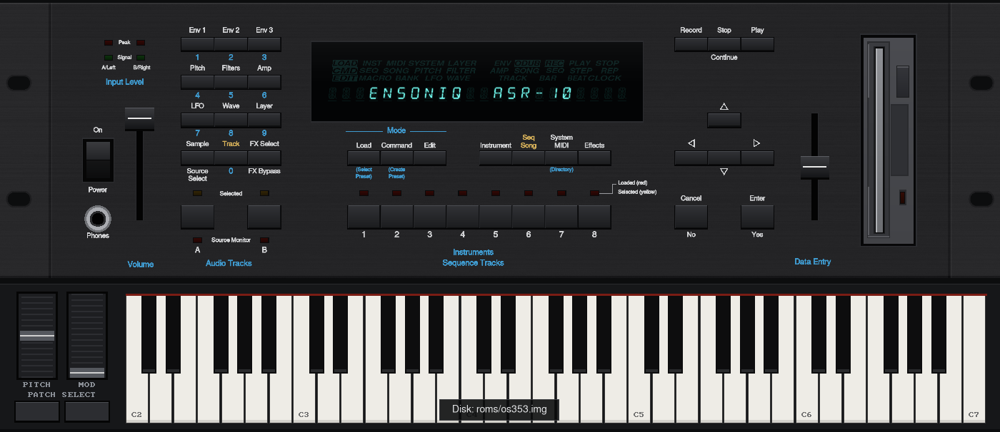
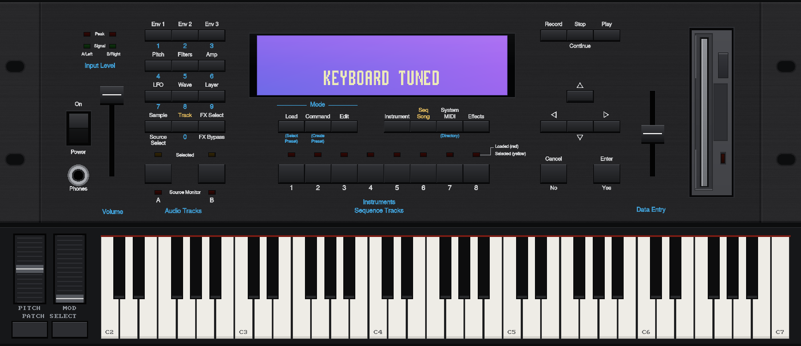

# Ensoniq ASR-10 Emulator



*Choose between the original VFD (above) and a purple graphic LCD, like the LCD replacement modules (below), in Options.*



A hardware-level emulator of the **Ensoniq ASR-10** (rack) sampler. It runs the original ROM and boots the
original operating system from a floppy image, on an emulated 68000 CPU, ES5506 (OTTO) sound chip,
ES5510 (ESP) effects DSP, floppy controller and SCSI. Nothing of the OS is faked, so it behaves like
the real instrument: sampling, effects, sequencer, Audio Tracks, disks.

Available as a **Windows app** and a **VST3 instrument plug-in**.

## What works

- Boot from the OS floppy (tested with OS 3.53), loading and saving instruments, banks and songs.
- 32-voice sound engine and all 50 ROM effects plus the effects stored in banks.
- Sequencer with correct tempo, MIDI In/Out.
- Sampling from your audio interface (or a WAV file).
- Audio Tracks, in RAM or on a SCSI disk (DiskTracks).
- SCSI drives (ZuluSCSI-style images): hard disks and CD-ROMs, booting the OS from SCSI.
- Import of **AKAI** (S1000/S1100) and **Roland** sample libraries from CD-ROM images on the SCSI bus
  (e.g. `CD5.iso` in the `scsi` folder), with the OS's own translation (OS 3.00 or later; 3.53 recommended).
- Output Expander outputs (AUX 1-3) on separate outputs of your audio interface.
- The full rack front panel, with an on-screen keyboard, pitch and mod wheels.
- Two display types: the original **VFD**, or a **purple graphic LCD** (View > Options > Display > Screen type). The VST3 plug-in follows the choice made in the app.

## Download

Get the latest **ASR10-Windows.zip** from the [Releases](../../releases) page. It contains:

| File | What it is |
|---|---|
| `asr10.exe` | the emulator |
| `asr10-cli.exe` | command-line version (tests, rendering to WAV) |
| `VST3/ASR10.vst3` | the VST3 instrument plug-in |

## You need your own ROM and OS disk

The ROM and the operating system belong to Ensoniq/E-mu and are **not included**. Put them in the
`roms` folder next to `asr10.exe`:

- the two v1.5 EPROMs: `asr-648c-lo-1.5b.bin` and `asr-65e0-hi-1.5b.bin` (or `asr_lo.bin` / `asr_hi.bin`);
- the OS floppy image, e.g. `os353.img`.

## Using it

- **Disks:** drag a floppy image (`.img`) onto the window, or one or more instruments (`.efa`/`.efe`):
  they are put on a temporary floppy in the drive, then use LOAD as usual. The drive's eject button
  ejects. File › Save Disk Changes (Ctrl+S) writes the floppy back to its image.
- **Power:** hold the Power button for about 1 s to restart the machine.
- **Boot from SCSI:** Options › SCSI drives › *Boot from* › "SCSI drive (no floppy at start)" starts the
  machine with an empty floppy drive, booting from a SCSI drive that has the OS on it (command line:
  `--boot scsi` / `--boot floppy`, this run only). The OS disk image is only ever taken from the `roms`
  folder next to the program: nothing is fetched from `%APPDATA%`, so deleting it there removes it.
- **Patch Select:** the two buttons on the keyboard strip work as on the ASR-10 keyboard (and the rack's rear Patch Select jack): click = held, right click = latched on/off (to have both, `**`), keys `[` and `]`.
- **Input Level pot:** left of the input LEDs (on the real rack it is on the back panel). Drag it up/down or use the mouse wheel over it; double click = 0 dB. Range: off to +18 dB (0 dB at two thirds of the travel). The gain is applied before the A/D, so the input LEDs and the OS level meter follow it, and too much gain clips as on the hardware.
- **SCSI activity LED:** the red LED above the floppy drive blinks while the SCSI bus is in use: slowly while reading, fast while writing.
- **ROMs not found:** the program lists the folders it searched and offers "Choose folder..."; the chosen folder is remembered (the plug-in uses it too).
- **Up + Down together** jumps to the middle of the value's range (0 for -99..+99, 50 for 0..99), as
  on the real unit: right-click an arrow, or press both arrow keys.
- **Options** (View › Options, Ctrl+O): audio driver (WASAPI, DirectSound, ASIO...), outputs, sample
  rate, buffer, AUX 1-3 routing, sampler input, MIDI ports, and the SCSI drives folder. Settings are
  kept in `%APPDATA%\Ensoniq\ASR10emu\asr10.cfg`.

**Computer keyboard** (it does not play notes: use a MIDI keyboard or the on-screen keyboard):

| Key | Function |
|---|---|
| 1–8, F1–F8 | Instrument•Track buttons 1–8 |
| numeric keypad | page buttons as printed: 1 Env 1 … 4 Pitch … 9 Layer, 0 Track |
| R / Space | RECORD / PLAY |
| Arrows | panel arrows |
| Enter / Esc | ENTER•YES / CANCEL•NO |
| F11 / F12 | Audio Track A / B |
| F9 | show/hide the on-screen keyboard |
| Ctrl+E / Ctrl+S / Ctrl+R | eject / save the floppy / reset |
| Ctrl+I | audio input on/off (for sampling) |

## SCSI drives

Put disk images named like on a ZuluSCSI in a folder: `HD0.img` is a hard disk on SCSI ID 0,
`CD5.iso` a CD-ROM on ID 5, and so on. By default the emulator uses a `scsi` folder next to it;
choose another one in Options › SCSI drives.

**New formatted drives:** in Options › SCSI drives pick a size (50 MB to 2 GB) and click
**Create HDn.img**. The image is created on the first free SCSI ID, already formatted exactly as the
ASR-10's FORMAT SCSI DRIVE does it, so it is ready to use. Restart the ASR-10 (Power) so that the OS
sees new drives.

## VST3 plug-in

1. Copy the whole `VST3\ASR10.vst3` folder to `C:\Program Files\Common Files\VST3`.
2. Run `asr10.exe` once: the plug-in then uses the same ROMs, OS disk, SCSI folder and settings as
   the app.
3. Rescan plug-ins in your host and load **ASR-10 Emulator** as an instrument.

- Outputs: Main plus AUX 1-3 (enable them in the host to get them separately); a stereo input for
  sampling and Audio Tracks; MIDI In and MIDI Out.
- The editor is just the panel: drag disk images or `.efa`/`.efe` files onto it, use the drive's eject
  button and the Power button, as in the app.
- The plug-in has no settings of its own: change them in the app and the plug-in follows.
- The project stores the volume and the disks in use; on reopening the ASR-10 boots again with them
  (RAM contents are not saved: load your sounds, as on the real unit).

## Building

Needs a C++17 compiler, CMake and SDL2 (or `-DASR10_BUNDLED_SDL=ON` to build it from source).

```sh
cmake -S . -B build && cmake --build build -j          # app and command-line version
cmake -S plugin -B build-vst && cmake --build build-vst # VST3 plug-in (downloads the VST3 SDK)
./build-mac.sh                                          # macOS: app + plug-in in dist/
```

Technical notes (emulated hardware, protocols, tests), in Portuguese: [docs/TECHNICAL-pt.md](docs/TECHNICAL-pt.md).

## Credits and licences

- **Musashi** 68000 core by Karl Stenerud; **ES5506/ES5510** algorithms derived from MAME
  (BSD-3-Clause); **RtMidi/RtAudio** by Gary P. Scavone; **SDL2** (zlib); **VST3 SDK/VSTGUI** by
  Steinberg (MIT). With ASIO support the Windows build is under GPLv3 (ASIO SDK). See `LICENSES/`.
- VST and ASIO are trademarks of Steinberg Media Technologies GmbH.
- Ensoniq and ASR-10 are trademarks of their owners. This project is not affiliated with them; the
  ROM and OS are not included.
