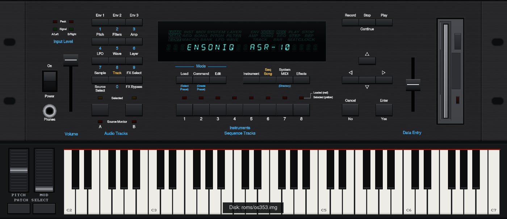
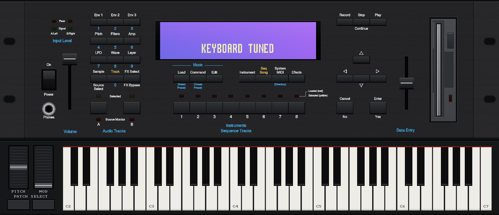

# Ensoniq ASR-10 Emulator



*Choose between the original VFD (above) and a purple graphic LCD, like the LCD replacement modules (below), in Options.*



A hardware-level emulator of the **Ensoniq ASR-10** (rack) sampler. It runs the original ROM and boots the
original operating system from a floppy image, on an emulated 68000 CPU, ES5506 (OTTO) sound chip,
ES5510 (ESP) effects DSP, floppy controller and SCSI. Nothing of the OS is faked, so it behaves like
the real instrument: sampling, effects, sequencer, Audio Tracks, disks.

Available as an app for **Windows** and **macOS** (Apple Silicon and Intel), as a **VST3 instrument plug-in**
for both and as an **Audio Unit** for Logic Pro and GarageBand, with installers or as portable packages.

## What works

- Boot from the OS floppy (tested with OS 3.53), loading and saving instruments, banks and songs.
- 32-voice sound engine and all 50 ROM effects plus the effects stored in banks.
- Sequencer with correct tempo, MIDI In/Out.
- Sampling from your audio interface (or a WAV file).
- Audio Tracks, in RAM or on a SCSI disk (DiskTracks).
- SCSI drives (ZuluSCSI-style images): hard disks and CD-ROMs, booting the OS from SCSI.
- Import of **AKAI** (S1000/S1100) and **Roland** sample libraries from CD-ROM images on the SCSI bus
  (e.g. `CD5.iso` in the `scsi` folder), with the OS's own translation (OS 3.00 or later; 3.53 recommended).
- Output Expander outputs (AUX 1-3) on separate outputs of your audio interface.
- **DI-10 Digital I/O** (S/PDIF): digital sampling at 44.1 or 48 kHz from a pair of inputs of your
  interface, and the digital output on a pair of its outputs.
- **TDA1541A** D/A converters modelled with the analog section after them (or a perfect converter).
- Floppy images: raw `.img`, Giebler `.ede` / `.eda` and HxC / Gotek `.hfe`.
- **Fast loading and saving** (optional), with the sequencer and DiskTracks always at real speed.
- The full rack front panel, with an on-screen keyboard, pitch and mod wheels, and computer keyboard
  shortcuts for every button.
- Two display types: the original **VFD**, or a **purple graphic LCD** (View > Options > Display > Screen type). The VST3 plug-in follows the choice made in the app.

## Download

Get the latest release from the [Releases](../../releases) page. Each system has an **installer**
(with an uninstaller) and a **portable** package (a folder to unzip anywhere, nothing installed).
The installer zips hold the installer (`Setup.exe` / `.dmg`), a README and the licences.

| | Installer | Portable |
|---|---|---|
| **Windows** (64-bit) | `ASR10-Emulator-Windows-Setup.zip` | `ASR10-Emulator-Windows-Portable.zip` |
| **macOS** (Apple Silicon and Intel, 11 or later) | `ASR10-Emulator-macOS-Installer.zip` | `ASR10-Emulator-macOS-Portable.zip` |

Both installers ask for **your own ROMs and OS disk**: the low and high firmware (`.bin`) and the
operating system disk image (`.img`, `.hfe`, `.ede` or `.eda`). They copy them into the program's `roms`
folder, where the app and the plug-ins find them, and do not go on without them.

**Windows installer:** the program goes in `C:\Program Files\ASR-10 Emulator` (with its `roms` and `scsi`
folders, which the installer makes writable for you), the VST3 plug-in in
`C:\Program Files\Common Files\VST3` (optional), Start menu shortcuts and a desktop shortcut.
Remove it with Settings › Apps or the Start menu's *Uninstall ASR-10 Emulator*: it asks whether to keep
your ROMs, disk images and settings.

**macOS installer:** the app goes in Applications › **ASR-10 Emulator** (with its `roms` and `scsi`
folders and an uninstaller), the VST3 plug-in in `/Library/Audio/Plug-Ins/VST3` and the **Audio Unit**
(Logic Pro, GarageBand) in `/Library/Audio/Plug-Ins/Components`; *Customize* lets you leave the plug-ins
out. It comes in a disk image (`.dmg`): open it, then *Install {prod}*. The installer is not signed by Apple: if macOS refuses to open it, right-click it › **Open** (or System
Settings › Privacy & Security › **Open Anyway**). To remove everything, open *Uninstall ASR-10 Emulator*
in the same folder (it can keep your ROMs, disk images and settings).

**Portable packages:**

| File | What it is |
|---|---|
| `asr10.exe` / `ASR-10.app` | the emulator |
| `asr10-cli(.exe)` | command-line version (tests, rendering to WAV) |
| `VST3/ASR10.vst3` | the VST3 instrument plug-in |
| `AU/ASR10.component` (macOS) | the Audio Unit (Logic Pro, GarageBand) |
| `roms/`, `scsi/` | where your ROMs/OS disk and SCSI disk images go |

### macOS portable package: what you need to know

1. **Keep the folder together.** Unzip and keep `ASR-10.app` with the `roms` and `scsi` folders next to
   it (the folder can go anywhere, e.g. in Applications or Documents): the app looks for them there.
2. **Allow the app to open, once.** The app is not notarized by Apple, so macOS refuses to open it
   ("cannot verify ..."). In Terminal, type `xattr -dr com.apple.quarantine ` (with a space at the end),
   drag the unzipped folder onto the window and press Enter. This also covers the plug-in.
   (Alternatively open the app once, then System Settings › Privacy & Security › **Open Anyway**.)
3. **ROMs and OS disk** go in `roms/` (see below). If they are not found, the app lists the folders it
   searched and offers **Choose folder…**; the folder you pick is remembered.
4. **Audio input** (sampling, Audio Tracks): macOS asks for microphone access the first time; allow it
   (or later in System Settings › Privacy & Security › Microphone).
5. **Menus:** File and View are in the macOS menu bar (⌘O open disk, ⌘E eject, ⌘S save disk changes,
   ⌘R reset, ⌘K keyboard, ⌘, options). The Ctrl shortcuts listed below work too.
6. **Plug-ins:** copy `VST3/ASR10.vst3` to `~/Library/Audio/Plug-Ins/VST3/` and, for Logic Pro,
   `AU/ASR10.component` to `~/Library/Audio/Plug-Ins/Components/` (Finder: Go › Go to Folder…), and open
   the app once first. More details: `README.txt` in the package.

## You need your own ROM and OS disk

The ROM and the operating system belong to Ensoniq/E-mu and are **not included**. Put them in the
`roms` folder next to `asr10.exe` (Windows) or `ASR-10.app` (macOS):

- the two v1.5 EPROMs: `asr-648c-lo-1.5b.bin` and `asr-65e0-hi-1.5b.bin` (or `asr_lo.bin` / `asr_hi.bin`);
- the OS floppy image, e.g. `os353.img`.

## Using it

- **Disks:** drag a floppy image (`.img`, a Giebler `.ede` / `.eda` image or an HxC / Gotek `.hfe` image) onto the window, or one or more instruments (`.efa`/`.efe`):
  they are put on a temporary floppy in the drive, then use LOAD as usual. The drive's eject button
  ejects. File › Save Disk Changes (Ctrl+S) writes the floppy back to its image.
- **Record a song to WAV:** File › Record Song to WAV… (Ctrl+W; ⇧⌘R on the Mac). Choose the folder; the
  recording then waits and starts when you press **Play** on the sequencer, and ends when the song
  ends or you press Stop (it goes on until the sound has died away). The file is 24-bit stereo at the
  audio device's sample rate and gets the name of the song / sequence, as shown on the Seq•Song page
  (open that page once so that the name is known; otherwise the file gets a generic name).
  Ctrl+W again cancels or stops.
- **Power:** hold the Power button for about 1 s to restart the machine.
- **Boot from SCSI:** Options › SCSI drives › *Boot from* › "SCSI drive (no floppy at start)" starts the
  machine with an empty floppy drive, booting from a SCSI drive that has the OS on it (command line:
  `--boot scsi` / `--boot floppy`, this run only). The OS disk image is only ever taken from the `roms`
  folder next to the program: nothing is fetched from `%APPDATA%`, so deleting it there removes it.
- **Patch Select:** the two buttons on the keyboard strip work as on the ASR-10 keyboard (and the rack's rear Patch Select jack): click = held, right click = latched on/off (to have both, `**`), keys `[` and `]`.
- **Input Level pot:** left of the input LEDs (on the real rack it is on the back panel). Drag it up/down or use the mouse wheel over it; double click = 0 dB. Range: off to +18 dB (0 dB at two thirds of the travel). The gain is applied before the A/D, so the input LEDs and the OS level meter follow it, and too much gain clips as on the hardware.
- **SCSI activity LED:** the red LED above the floppy drive blinks while the SCSI bus is in use: slowly while reading, fast while writing.
- **ROMs not found:** the program lists the folders it searched and offers "Choose folder..."; the chosen folder is remembered (the plug-in uses it too).
- **Up + Down together** jumps to the middle of the value's range (0 for -99..+99, 50 for 0..99), as
  on the real unit: right-click an arrow, or press both arrow keys.
- **Options** (View › Options, Ctrl+O): audio driver (Windows: WASAPI, DirectSound, ASIO...; macOS:
  Core Audio), outputs, sample rate, buffer, AUX 1-3 routing, sampler input, MIDI ports, and the SCSI
  drives folder. Settings are kept in `%APPDATA%\Ensoniq\ASR10emu\asr10.cfg` (macOS:
  `~/Library/Application Support/Ensoniq/ASR10emu/asr10.cfg`).

**Computer keyboard** (it does not play notes: use a MIDI keyboard or the on-screen keyboard):

| Key | Function |
|---|---|
| 1–8, F1–F8 | Instrument•Track buttons 1–8 |
| numeric keypad | page buttons as printed: 1 Env 1 … 4 Pitch … 9 Layer, 0 Track |
| L / E / C | LOAD / EDIT / COMMAND |
| G / H / J / K | INSTRUMENT / SEQ•SONG / SYSTEM•MIDI / EFFECTS |
| Ctrl+E | FX SELECT•FX BYPASS |
| R / Space / Ctrl+Space (or Shift+Space) | RECORD / PLAY / STOP•CONTINUE |
| Arrows | panel arrows |
| Enter / Esc | ENTER•YES / CANCEL•NO |
| N / M (or F11 / F12) | Audio Track A / B |
| Z / X (or [ / ]) | Patch Select left / right |
| F9 | show/hide the on-screen keyboard |
| Ctrl+Shift+E / Ctrl+S / Ctrl+R | eject / save the floppy / reset |
| Ctrl+I | audio input on/off (for sampling) |

## SCSI drives

Put disk images named like on a ZuluSCSI in a folder: `HD0.img` is a hard disk on SCSI ID 0,
`CD5.iso` a CD-ROM on ID 5, and so on. By default the emulator uses a `scsi` folder next to it;
choose another one in Options › SCSI drives.

**New formatted drives:** in Options › SCSI drives pick a size (50 MB to 2 GB) and click
**Create HDn.img**. The image is created on the first free SCSI ID, already formatted exactly as the
ASR-10's FORMAT SCSI DRIVE does it, so it is ready to use. Restart the ASR-10 (Power) so that the OS
sees new drives.

## Fast loading and saving

While a file is loaded or saved (floppy or SCSI) the emulated ASR-10 runs as fast as the computer
allows instead of at its real speed, so loads, saves and booting take a fraction of the time (booting
from the OS disk: ~5 s instead of ~15 s). The sound is muted meanwhile (it fades out and back in).
It stays at real speed while the sequencer plays or records, so Audio Tracks on disk and songs keep
their timing. Options › Display, sound and disks › **Loading / saving**: *Fast* (default) or *Real
speed*. The VST3 plug-in follows the app's choice; in a host it runs ahead with up to ~40% of each
audio block's time, so the speed-up there is smaller.

## DI-10 Digital I/O (S/PDIF)

The DI-10 was Ensoniq's digital I/O option (Crystal CS8412-CP receiver, CS8402 transmitter). In
Options choose **Digital In (DI-10 S/PDIF)** (a pair of inputs of the input device: your interface's
S/PDIF input, or any other pair) and/or **Digital Out (DI-10 S/PDIF)** (a pair of outputs). The board
is fitted as soon as either is used, and the ASR-10 restarts (its OS looks for the board at start).

- **Digital sampling:** press Sample; the display shows `REC SRC=INPUTDRY LEFT`. Move the cursor left
  and take the value up to `DIGITAL`. Without the board the values stop at MAIN-OUT, as on the real unit.
  The OS measures the incoming rate: at 44.1 or 48 kHz the samples get that rate. With the interface
  at 44.1 or 48 kHz the samples arrive untouched (the first 16 bits of each word, as the ASR-10 takes
  them). The receiver behaves as the CS8412-CP: it locks to 25-55 kHz, so a 32 kHz source is
  sampled at 32 kHz but labelled 44.1 kHz by the OS (as on the real unit); out of lock it outputs
  silence (the board is still seen: its clock then runs at the VCO's minimum); on a gap it repeats the
  last good sample. An interface at 88.2 / 96 / 176.4 / 192 kHz is taken down to 44.1 / 48 kHz.
- **Digital output:** the Main output mix (not AUX 1-3) as 16-bit data, when the current effect runs
  at 44.1 kHz. With a 30 kHz effect the output is off, as the service manual says. With the interface
  at 44.1 kHz the data is untouched; at other rates it is converted.
- VST3: the plug-in follows the app. Its stereo input is also the S/PDIF input, and an extra output
  bus, **S/PDIF Out (DI-10)**, carries the digital output.

## D/A converters

The outputs go through a model of the machine's Philips TDA1541A converters (16-bit words with each
chip's small bit-weight errors, no oversampling filter so each sample is held for a whole period) and
of the analog section after them (I/V converter, low-pass filter, coupling capacitor), then are
resampled to the computer's rate. Options › Display, sound and disks › **D/A converters**: *TDA1541A (as the
ASR-10)* (default) or *Ideal (perfect converter)*, which only resamples.

## VST3 plug-in and Audio Unit

1. The installers put the plug-ins in place. From a portable package, copy the whole `VST3\ASR10.vst3`
   folder to `C:\Program Files\Common Files\VST3` (Windows) or to `~/Library/Audio/Plug-Ins/VST3/`
   (macOS), and on macOS `AU/ASR10.component` to `~/Library/Audio/Plug-Ins/Components/` (Logic Pro,
   GarageBand and other Audio Unit hosts).
2. Run the app (`asr10.exe` / `ASR-10.app`) once: the plug-in then uses the same ROMs, OS disk, SCSI folder and settings as
   the app.
3. Rescan plug-ins in your host and load **ASR-10 Emulator** as an instrument (in Logic Pro:
   Instrument › AU Instruments › ASR10emu › ASR-10 Emulator; Logic lists a *Multi-Output* version too
   when it can use the extra outputs).
- The Audio Unit is the VST3 inside Steinberg's AU wrapper (`Contents/Resources/plugin.vst3`): it works
  the same way.

- Outputs: Main plus AUX 1-3 (enable them in the host to get them separately), and S/PDIF Out when
  the app fits the DI-10; a stereo input for sampling and Audio Tracks; MIDI In and MIDI Out.
- The editor is just the panel: click the drive slot to choose a disk image (`.img`, `.ede`, `.eda`, `.hfe`) or
  instrument files, or drag them onto the panel (where the host passes drops on to plug-ins), use the drive's eject
  button and the Power button, as in the app.
- The plug-in has no settings of its own: change them in the app and the plug-in follows.
- The project stores the volume and the disks in use; on reopening the ASR-10 boots again with them
  (RAM contents are not saved: load your sounds, as on the real unit).

## Building

Needs a C++17 compiler, CMake and SDL2 (or `-DASR10_BUNDLED_SDL=ON` to build it from source).

```sh
cmake -S . -B build && cmake --build build -j          # app and command-line version
cmake -S plugin -B build-vst && cmake --build build-vst # VST3 plug-in (downloads the VST3 SDK)
./build-mac.sh                                          # macOS: app + plug-ins + packages in dist/
```

On macOS, `./build-mac.sh` builds the app, the VST3 and the Audio Unit and makes both packages (the
installer with `installer/mac/make-pkg.sh`). The Windows packages are made by `installer/windows/package.sh`
(NSIS for the installer); `.github/workflows/windows.yml` shows the whole cross-compiled build.

Technical notes (emulated hardware, protocols, tests), in Portuguese: [docs/TECHNICAL-pt.md](docs/TECHNICAL-pt.md).

## Credits and licences

- This program is free software under the **GNU GPL v3** (`LICENSE`).
- **Musashi** 68000 core by Karl Stenerud; **ES5506/ES5510** algorithms derived from MAME
  (BSD-3-Clause); **RtMidi/RtAudio** by Gary P. Scavone; **Steinberg ASIO SDK** (GPLv3);
  **SDL2** (zlib); **VST3 SDK** (MIT) and **VSTGUI** (BSD-3-Clause) by Steinberg; the macOS Audio Unit
  is built with Apple's **AudioUnitSDK** (Apache 2.0); the Windows installer is made with **NSIS**
  (zlib/libpng, bzip2 and CPL licences); panel and
  options page lettering rendered from **GNU FreeFont** FreeSans (GPLv3 with the font exception);
  the 8x8 bitmap font by Daniel Hepper (public domain). The licence texts are in `LICENSES/` (and
  next to Musashi, RtMidi and RtAudio in their folders).
- VST and ASIO are trademarks of Steinberg Media Technologies GmbH.
- Ensoniq and ASR-10 are trademarks of their owners. This project is not affiliated with them; the
  ROM and OS are not included.
